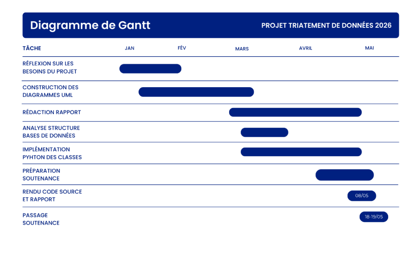

\begin{titlepage}
\centering

\vspace*{1cm}

\includegraphics{images/ensai_logo_1.png}\\
\vspace{1.0cm}

{\LARGE\textsc{Projet de traitement de données}}\\
\vspace{0.5cm}
{\large Élèves 1A}

\vspace{2.5cm}

\rule{\textwidth}{0.5mm}\\
\vspace{0.8cm}
{\huge\bfseries Rapport du projet informatique}\\ 
\vspace{0.8cm}
\rule{\textwidth}{0.5mm}\\

\vspace{3.5cm}

\begin{minipage}[t]{0.5\textwidth}
\begin{flushleft}
\emph{Étudiants :}\\
Cedric Martins\\
Corentin Lematte\\
Maxime Yvano\\
Hugo Lhommeau
\end{flushleft}
\end{minipage}% 
\begin{minipage}[t]{0.5\textwidth}
\begin{flushright}
\emph{Tuteur :}\\
Donatien Eneman\\

\end{flushright}
\end{minipage}

\vfill
\begin{center}
2025--2026
\end{center}
\end{titlepage}

\tableofcontents

# Introduction

Les Jeux Olympiques de Paris 2024 ont connu un succès retentissant. Par conséquent l'Etat souhaite davantage investir dans le sport et aurait besoin notamment d'une application qui lui permette de gérer les résultats de compétitions sportives. L'objectif de ce projet est justement de développer cette application. Pour coller aux attentes, un certain nombre de fonctionnalités sont à intégrer à l'application. Ces fonctionnalités sont regroupées dans un cahier des charges présenté ci-après.

## Cahier des charges

- L'application modélise au minimum des matchs, des compétitions, des équipes ou des joueurs et joueuses, et permet de fournir des statistiques de ces objets;
- Il doit être possible d'ajouter les résultats d'une nouvelle compétition et de mettre à jour les résultats et caractéristiques des différentes classes;
- L'application doit pouvoir fonctionner sur plusieurs jeux de données différents et doit donc être adaptable.

## Plan du rapport

Le rapport est structuré autour de plusieurs grandes parties. Pour commencer, nous présentons les caractéristiques fonctionelles, c'est-à-dire toutes les fonctionnalités que permet notre application, ainsi que les caractéristiques techniques permettant ces opérations. Nous fournissons notamment le diagramme de cas d'utilisations dans la partie caractéristiques fonctionnelles. Dans la partie caractéristiques techniques, nous expliquons l'architecture de notre code en expliquant nos choix et fournissons également le diagramme de classes de notre projet. Ensuite, nous abordons les différentes difficultés rencontrées au cours de ce projet. La partie suivante concerne l'assurance qualité de notre code. Nous abordons ici le linter utilisé, les tests effectués ainsi que la documentation de notre code. Enfin, nous finissons par un retour d'expérience individualisé dans lequel chacun de nous explique entre autres la manière d'aborder le projet, ce qu'il referait différemment, et les compétences acquises, avant de finir sur une conclusion.

# Caractéristiques fonctionelles

La principale caractéristique est de permettre aux utilisateurs de récupérer des données provenant de bases de données sur le thème du sport. Par exemple, ils doivent pouvoir récupérer pour chaque sport les joueurs, les matchs ou les équipes si ces données sont présentes dans la base considérée. De plus, un administrateur doit pouvoir actualiser les bases de données depuis la même application. Nous avons fait le choix de ne pas implémenter de profil utilisateur et administrateur à ce stade du projet, car cela ne nous semble pas nécessaire.

Il doit être également possible d'obtenir des statistiques sur chaque base de données, comme le nombre de matchs gagnés par un joueur, le calendrier des matchs ou la liste des joueurs pour une équipe...

{width="105%" fig-align="left"}

Pour respecter le cahier des charges, il est nécessaire de pouvoir récupérer des données d'une multitude de bases de données, indépendamment de leurs formes. Cela permet de rajouter une base de données sans refaire toute l'implémentation, ce qui facilite la maintenance de l'application.

# Caractéristiques techniques

Nous allons expliquer en détails les caractéristiques techniques de notre projet permettant l'obtenir les caractéristiques fonctionnelles mentionnées dans la partie précédente. Nous commencerons par présenter l'architecture de notre code, avant d'expliquer les différentes parties de celui-ci. Nous nous aiderons du diagramme de classes de notre projet pour expliquer nos différents choix.

## Architecture du code

Notre code est découpé en plusieurs parties qui communiquent entre elles.Nous disposons de 5 dossiers différents ainsi que d'un fichier "main" qui regroupe ces parties. Ces parties sont :  \

- "models" : dossier contenant les classes générales. Nous précisons générales car elles ne sont pas définies pour une certaine base de données conformément au cahier des charges. Elles sont au nombre de 4 : une classe "Competition", "Equipe", "Joueur" et "Match". Nous avons crée la classe "Compétition" car les bases de données contiennent des compétitions sportives et l'objectif du rapport est de gérer les résultats de ces compétitions sportives. Les classes "Equipe", "Joueur" et "Match" sont ensuite les composants essentiels de ces compétitions sportives et nous disposons de plus d'informations sur ces objets; \

- “Adapter” : dossier contenant ce qu’on a appelé des “adapters”. Ce sont des classes qui permettent de faire le lien entre nos classes générales et les bases de données. Pour cela, nous mettons en correspondance les colonnes d’une base de données avec les attributs des classes. On adapte finalement les variables de la base de données aux attributs de nos classes générales afin de pouvoir respecter l’adaptabilité de notre code exigé dans le cahier des charges; \

- "Repository" : dossier permettant la création d'un objet appelé "DataRepository" qui a pour but de charger les données d'une base de données en lui fournissant certaines informations, à savoir un séparateur, un chemin aboutissant à un fichier et un un adapter; \

- “config” : dossier contenant le fichier “DataSet_configuration.py”. Ce fichier a pour but de fournir le séparateur, le chemin menant à un fichier et l’adapter pour chacun des bases de données permettant ensuite de charger les données dans le fichier “main”; \

- “services” : Il s’agit des différentes fonctionnalités proposées pour chacune de nos classes générales ainsi que pour leurs statistiques respectives. On crée pour ce faire différentes classes services. 

# Difficultés rencontrées

## Sport différent

En cherchant à uniformiser le traitement des bases de données, nous nous sommes rendu compte que certains sports ont un système de jeu très différent des autres. Par exemple, le traitement des scores a été complexe pour le tennis, car il faut prendre en compte l'ensemble des sets et non juste le score final. De plus, la présence d'abandons ou de forfaits entraîne, dans certains matchs, l'absence d'un vainqueur désigné par le score. Pour régler ce problème, nous avons ajouté la valeur -1 afin de prendre en compte ces cas particuliers.

## Calendrier du projet

Initialement, nous avions prévu de suivre le diagramme de Gantt réalisé au début de notre projet.

{width="100%" fig-pos="H"}
Cependant, plusieurs événements nous ont contraints à décaler la rédaction du rapport et du code en lui-même. Tout d'abord, l'accumulation des rendus de projets extérieurs à celui-ci et les obligations personnelles ont rendu compliqué de se rendre tous disponibles pour les réunions de projet. Nous avons alors utilisé des plateformes en ligne pour communiquer sur l'avancement de chacun et pouvoir échanger sur les tâches à accomplir. Grâce à cela, nous avons pu finir les rendus dans les délais demandés

\newpage
\vspace*{1cm}
## Format date de naissance/nom complet

Dans les différentes bases de données, les dates de naissance et les noms complets n'avaient pas du tout la même forme, ce qui a compliqué leur traitement. Concernant les noms, soit le nom et le prénom étaient séparés, soit ils étaient réunis, ou bien nous n'avions qu'un des deux. De plus, certaines personnes ont des noms en plusieurs parties, ce qui rend complexe l'identification. Pour les dates de naissance, nous avons rencontré le même problème, mais l'ordre des éléments était ici encore plus critique en raison de la coexistence des formats américain (mm/dd/yyyy) et français (dd/mm/yyyy). Nous avons donc décidé d'uniformiser ces données dans le format le plus commun pour chacune d'elles.

# Assurance qualité

Pour assurer la qualité de notre code, nous avons choisi le linter Pylint afin de vérifier notamment l'indentation et l'uniformité du style. Nous avons obtenu une note de [note] pour notre code. Il repère des problèmes tels que [exemple de problème].

Nous avons effectué des tests sur les fonctionnalités statistiques principales, comme [exemple de test]. Nous avons également documenté chaque adaptateur afin de préciser ce qu'il prend en entrée et ce qu'il renvoie en sortie.

# Retour d'expérience

## Maxime Yvano

Le projet s'est bien passé dans l'ensemble personnellement. Le sujet était intéressant et nous permettait d'imaginer des fonctionnalités qu'on utilise nous-mêmes sur des applications déjà existantes. La partie la plus difficile du projet est l'organisation du code et la méthode à appliquer pour avoir un code général et qui reste propre. Réfléchir sur cette structure dès les premières séances aurait été mieux que de faire des schémas qui ne se basent que sur des hypothèses de comment les bases de données seront. Le projet a un grand potentiel d'approfondissement si on passe beaucoup plus de temps dessus.

## Corentin Lematte

Je trouve que ce projet de traitement de données s'est bien passé pour moi, malgré quelques difficultés de compréhension concernant la logique de l'implémentation. Par exemple, le fait de devoir travailler directement avec des fichiers CSV via des bibliothèques dédiées pour récupérer et envoyer des données m'a paru complexe dans un premier temps. De plus, le fait que les bases de données n'aient pas été données dès le début nous a fait perdre du temps au démarrage du projet, car nous ne savions pas vraiment sur quoi nous travaillions. Cependant, grâce à un bon travail de groupe, j'ai apprécié la liberté qui nous a été accordée dans le choix des fonctionnalités à implémenter.

## Cedric Martins

"Ce projet de traitement de données a été une expérience très formatrice, en particulier sur l'aspect architectural. J'ai trouvé très intéressant de devoir concevoir un système capable de s'adapter à différentes sources de données, ce qui m'a permis de mieux comprendre l'importance de l'abstraction en programmation. Bien que l'absence de bases de données concrètes au départ ait rendu la phase de conception initiale assez abstraite et parfois incertaine, cela nous a forcés à être plus rigoureux dans notre logique de développement. La collaboration au sein du groupe a été fluide, et la liberté d'ajouter des fonctionnalités personnalisées a été un vrai moteur pour s'investir dans le projet. Au final, je repars avec une meilleure maîtrise de la gestion des flux de données et une vision plus claire de la structuration d'une application complexe."

\newpage
\vspace*{1cm} 
## Hugo Lhommeau

Pour ma part, le projet s'est bien déroulé dans l'ensemble. Le projet m'a permis de mettre en pratique la programmation objet et l'élaboration d'un rapport avec notamment la confection de diagrammes UML. De plus, le caractère reproductible du projet pour différentes bases de données est un bon réflexe à acquérir pour les futurs projets informatiques et notamment en attachant un soin particulier à leur logique et structure interne. Toutefois, il n'était pas évident de trouver la bonne manière de faire, ce qui a fait que j'ai eu le sentiment d'être un peu perdu au début du projet. Enfin, le projet nous laissait suffisamment de liberté pour décider des fonctionnalités que l'on voulait intégrer.

# Conclusion

En définitive, ce projet nous a permis de mettre en pratique la théorie vue dans le cours de programmation orientée objet, ainsi que le travail d'équipe dans le cadre d'un projet informatique. En effet, l'application se voulant la plus adaptable possible, les diagrammes UML nous ont aidés à bien identifier les fonctionnalités que nous voulions implémenter. La programmation orientée objet a été essentielle pour définir clairement, grâce aux classes, les objets que nous allions manipuler. Concernant le travail d'équipe, l'usage de Git et des messageries électroniques nous a permis un partage de l'information sûr, rapide et efficace.

De plus, le projet pourra être amélioré à l'avenir par l'ajout de plusieurs fonctionnalités. On peut envisager un système d'identification pour séparer les droits de l'utilisateur de ceux de l'administrateur, ou encore permettre de garder en mémoire les recherches de l'utilisateur. De même, une interface graphique permettrait une meilleure lisibilité des résultats et des actions possibles.
