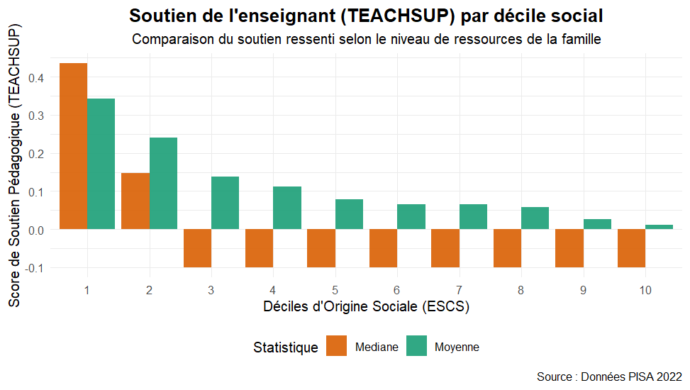
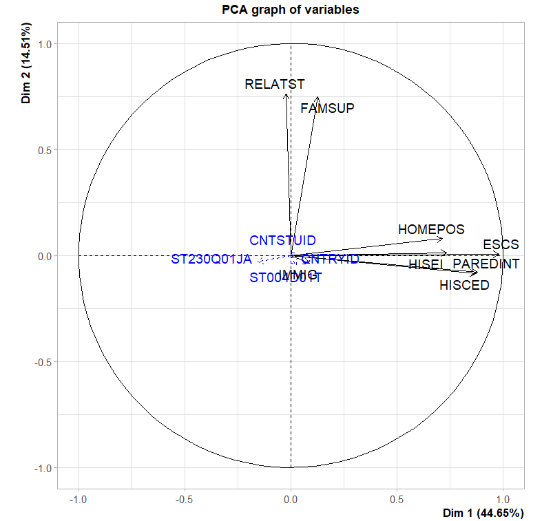
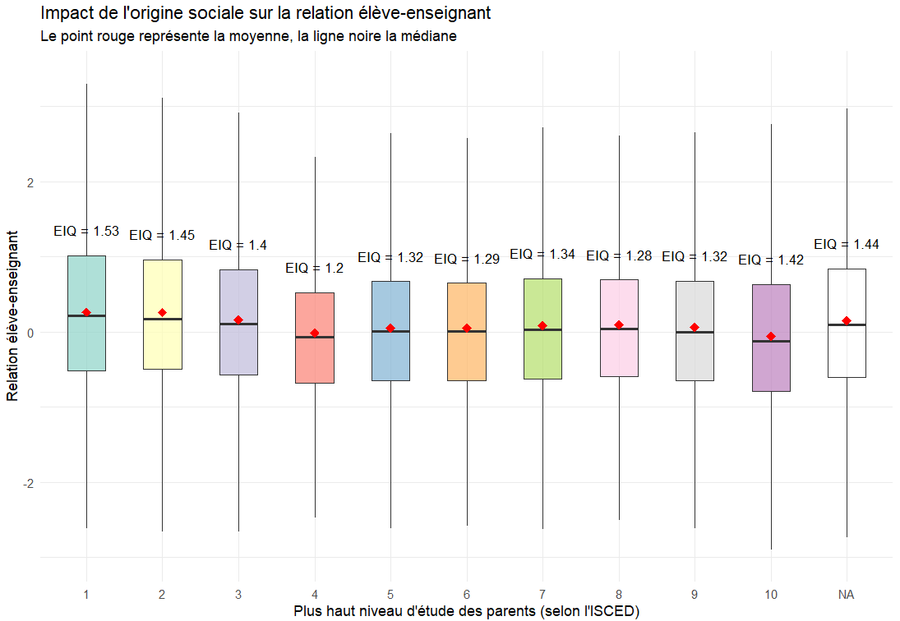
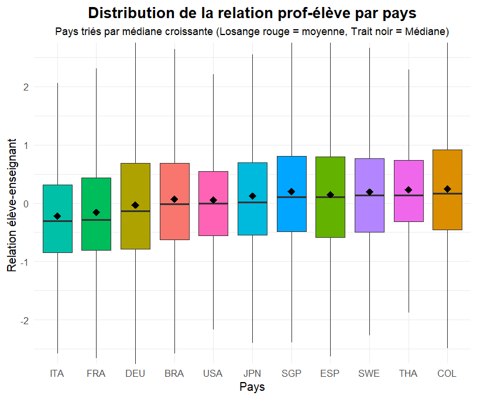
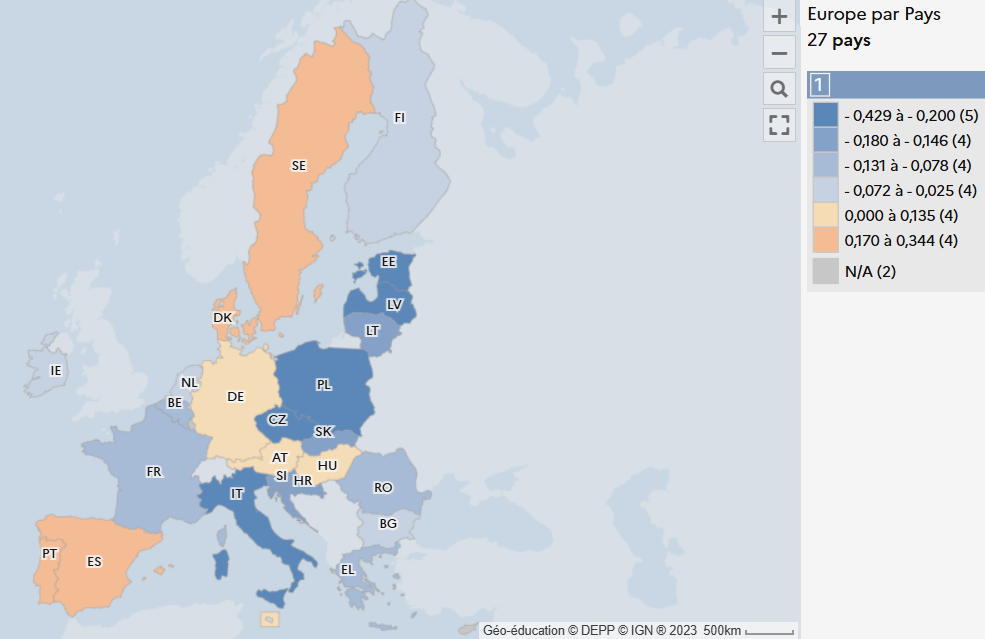
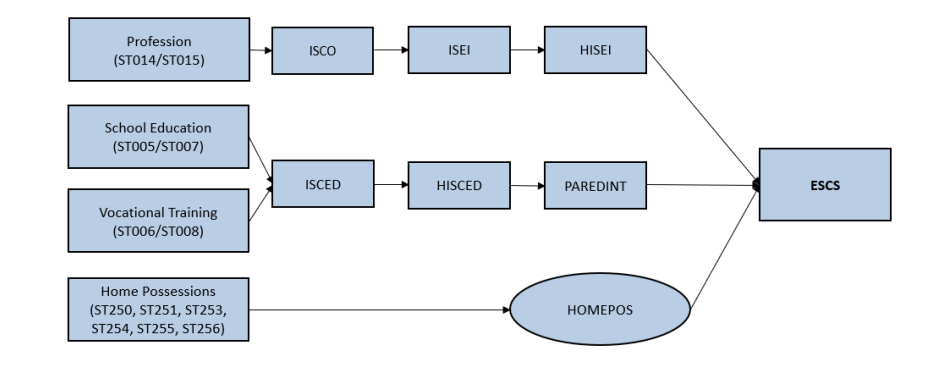
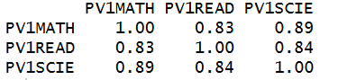

\begin{titlepage}
\centering

\vspace*{1cm}

\includegraphics{images/ensai_logo_1.png}\\
\vspace{1.0cm}

{\LARGE\textsc{Projet de statistique}}\\
\vspace{0.5cm}
{\large Élèves 1A}

\vspace{2.5cm}

\rule{\textwidth}{0.5mm}\\
\vspace{0.8cm}
{\huge\bfseries Caractérisation des relations \\[1cm] élèves-enseignants}\\ 
\vspace{0.8cm}
\rule{\textwidth}{0.5mm}\\

\vspace{3.5cm}

\begin{minipage}[t]{0.5\textwidth}
\begin{flushleft}
\emph{Étudiants :}\\
Cedric Martins\\
Corentin Lematte\\
Maxime Yvano
\end{flushleft}
\end{minipage}% 
\begin{minipage}[t]{0.5\textwidth}
\begin{flushright}
\emph{Chargé de techniques rédactionnelles :}\\
Antoine Rault\\
\emph{Tuteur :}\\
Vladimir Azzopardi\\

\end{flushright}
\end{minipage}

\vfill
\begin{center}
2025--2026
\end{center}
\end{titlepage}

\tableofcontents

# Introduction

\mbox{}\hspace{0.6cm}Selon la Direction de l'évaluation, de la prospective et de la performance (DEPP), en 2024, un enseignant travaillant dans un lycée dans les voies générale et technologique effectue son cours devant en moyenne 23,9 élèves. Cette moyenne est plus basse pour les formations professionnelles en lycée, avec 15,3 élèves par enseignant [1]. De ce fait, le temps consacré à chaque élève diffère significativement selon la voie choisie. Cette différence impacte la proximité du professeur envers ses élèves, ce qui peut affecter la qualité de son enseignement et le bien-être dans la classe. Ce phénomène de répartition inégale souligne le rôle important de la relation élèves-enseignants, qui est un enjeu majeur du système éducatif car elle constitue le lien direct entre l’institution et les étudiants. Par exemple, la présence d'adultes attentifs, notamment les professeurs, permet de diminuer les actes de harcèlement entre pairs, ce qui assure un cadre plus sûr à l'école.

\mbox{}Notre rapport consiste alors en une étude des différentes composantes de cette relation en fonction de plusieurs facteurs. Les relations élèves-enseignants seront ici considérées dans leur sens large, avec une attache au résultat scolaire et à l'attention émotionnelle du professeur. Dans ce rapport, nous cherchons donc à savoir comment caractériser les relations élèves-enseignants.

\mbox{}Dans un premier temps, il sera utile d'étudier les propriétés des relations élèves-enseignants. En effet, on peut voir que ces relations peuvent différer selon la zone géographique considérée et la condition sociale de l'élève. Cela nous amènera à effectuer une typologie de ces relations. Dans un second temps, nous pourrons observer les impacts de ces relations dans les domaines scolaire et extrascolaire, qui sont tout autant importants pour le développement des étudiants. L'exemple de la crise Covid permet de plus de mesurer l'évolution et l'impact de cette relation durant cette période de confinement.

\mbox{}Les données utilisées viennent des réponses des élèves à l'enquête PISA 2022, qui a pour but de mesurer les caractéristiques scolaires d'élèves de 15 ans venant de 80 pays de l'Organisation de coopération et de développement économiques (OCDE). Il est important de noter que cette étude ne prend pas en compte les réponses des professeurs ; il faut donc mettre en perspective les réponses des étudiants selon le contexte. Il est également important de rappeler qu’il existe d’autres relations fondamentales dans le développement éducatif de l’élève, comme celle avec ses parents ou ses pairs. Le harcèlement scolaire venant des camarades est la cause de 25 % des cas d’absentéisme chronique ; ainsi les relations entre élèves ne sont pas à mettre de côté, même si nous ne les développerons pas dans cette étude [2]. 

\vspace{0.8cm}

Pour la manipulation des données, nous avons choisi d'exclure les élèves pour lesquels plus de 30 % des réponses n'étaient pas fournies. Ceux-ci représentent 4 % des élèves de la base, nous avons considéré que l'échantillon était suffisamment conséquent pour qu'on puisse les écarter de l'étude afin d’avoir un échantillon plus maniable pour nos analyses.

Les questions du questionnaire sont regroupées par thème, ainsi à partir d'un bloc de questions l'OCDE a pu créer des variables chiffrées représentatives d'une caractéristique. Ces variables sont réduites et centrées en 0, de sorte que le 0 corresponde à la moyenne des élèves de l'OCDE. Pour notre sujet nous avons utilisé plusieurs de ces variables :
RELATST et TEACHSUP représentent respectivement la qualité globale des relations de l'élève avec l'enseignant, et le soutien du professeur au niveau de l'apprentissage. Pour évaluer les conditions sociales de l'élève nous utiliserons l'indice ESCS qui correspond au statut socio-économique de l'élève (Voir méthode de calcul en annexe). Nous avons aussi accès à l'origine géographique de l'élève et à son statut migratoire. Enfin nous pourrons évaluer l'impact de la relation prof-élève sur les résultats scolaires. En effet, la base donne accès aux résultats des élèves à un test de mathématiques via les variables PVMATH, et de même pour un test de science et de lecture. Au vu des corrélations obtenues entre les résultats des différentes matières (voir annexe) nous pourrons, sans grande perte de généralité, nous intéresser uniquement aux résultats en mathématiques pour caractériser le niveau de l'élève. 

#  1. Étude des relations élèves-professeurs

##  1.1 Impact de l’origine sociale

Comme on peut le lire dans la littérature, l’origine sociale des élèves et donc de leurs parents, a un impact sur leur scolarité. On peut alors légitimement se demander si l'origine sociale de l'élève et sa relation avec les professeurs ont un lien. Pour tester cela nous disposons dans la base de données de l'enquête Pisa 2022, d'une variable ESCS, indice représentant le statut économique, social et culturel de la famille de l'élève. Nous allons la comparer à une variable nommée “RELATST” qui évalue la relation entre l'élève et le professeur, ainsi que “TEACHSUP” qui elle représente le soutien que l'élève ressent de la part de ses professeurs. Ces 3 variables sont quantitatives, d'écart type 1, et centrées en zéro de sorte à ce que le zéro corresponde à la moyenne des élèves de l'OCDE. 
Les coefficient de corrélation obtenues sont de -0.02 entre ESCS et relation prof-élève, et de -0.08 entre ESCS et soutien du professeur. Ces valeurs ne permettent pas d’affirmer directement une corrélation entre ces caractéristiques. Pour creuser sur ce lien, nous allons nous intéresser aux élèves aux extrémités de l’échelle sociale. Pour cela on découpe la population en déciles comme ci dessous :

{#fig-analyse-pisa width="90%"}

\vspace{0.5cm}
On observe là des phénomènes différents selon l'origine sociale des élèves. Les 60% de la population entre les déciles 3 et 8 ont une relation avec leur professeurs dans la moyenne de l'OCDE. Cependant pour les 20% les plus défavorisés et les 20% les plus favorisés on observe de meilleures relations avec leurs professeurs que la moyenne. Cela est surtout notable pour les 10% les plus défavorisés qui divergent de 0.18 points par rapport à la moyenne de l'OCDE. Cela va à l'encontre de l'idée selon laquelle les élèves les plus pauvres auraient les moins bonnes relations avec leurs professeurs. 
Regardons le même graphe avec la variable portant sur le soutien ressenti par l'élève de la part de son professeur.

{#fig-teach width="90%"}

\vspace{0.5cm}

Le soutien perçu par les élèves de la part de leurs professeurs décroît lorsque le rang social augmente. On voit là encore une nette différence pour les 10% d’élèves les plus défavorisés qui dévissent de 0.34 points par rapport à la moyenne de l’OCDE, et avec une médiane encore plus élevée à 0.44 points. Cela suggère un phénomène de "sur-accompagnement" ou de bienveillance accrue de la part des enseignants envers les élèves les plus fragiles socialement. 
De manière générale les élèves les plus défavorisés semblent donc entretenir des relations avec leurs professeurs légèrement meilleures que la moyenne des élèves de l’OCDE. 

<!-- Comme on peut le lire dans la littérature, l’origine sociale des élèves et donc de leurs parents a un impact sur la scolarité de ces enfants. Un des premiers liens que nous pouvons voir est celui lié à l’aide apportée par la famille. Comme on peut le voir sur ce cercle des corrélations produit à partir d’une ACP regroupant les variables liant origine sociale et relation élève-enseignant. On peut voir que la variable résumant la relation élève-enseignant (RELATST) et l’aide apportée par la famille (FAMSUP) sont proches et toutes les deux bien représentées, ce qui nous permet de conjecturer un lien entre elles. -->

<!-- {#fig-cercle width="70%"} -->

<!-- \vspace{0.8cm} -->

<!-- On peut ensuite se concentrer sur les rapports de corrélations entre les différentes variables sélectionnées pour cette partie. Encore ici, on voit que RELATST et FAMSUP partagent un lien, même faible. En calculant le coefficient de détermination, on trouve que la variable FAMSUP explique 4 % de la variable RELATST. On prouve donc un lien, même mineur, entre ces deux aspects après l’avoir conjecturé auparavant. -->

<!-- \vspace{0.8cm} -->

<!-- Nous nous sommes ensuite concentrés sur le lien avec le niveau d’études des parents. Là aussi nous trouvons des résultats peu significatifs mais présents tout de même. On peut voir que les écarts interquartiles sont les plus grands pour les valeurs extrêmes. Les enseignants ont des comportements plus variables pour les élèves avec des parents peu ou très éduqués, ce qu’on peut expliquer par le fait que les élèves sont désintéressés de l’école ce qui n’aide pas avec les relations. Puis on peut voir qu'en moyenne, les relations se dégradent jusqu’à rester assez constantes à partir d’un niveau similaire au baccalauréat et plus.  -->

<!-- {#fig-boxplot width="70%"} -->

## 1.2 Différences par pays

Maintenant, nous allons nous focaliser sur cette relation entre élèves et enseignants mais dans différents pays. Les systèmes éducatifs et les mœurs étant très différents d’un pays à l’autre, nous pourrons analyser cela grâce à l’analyse des données.

En effectuant une étude sur dix pays sélectionnés parmi ceux ayant participé à l’enquête PISA 2022 et venant de différents continents pour essayer d’être assez général, on obtient de premiers résultats. Des pays européens comme la France et l’Italie semblent entretenir une plus faible relation avec leurs professeurs que la plupart des autres pays. Nous pouvons souligner que le fait d’appartenir à un pays développé (France, États-Unis) ne semble pas améliorer cette relation, notamment en comparant avec la Thaïlande ou la Colombie. De plus, nous pouvons observer une distinction au sein d’un même continent avec une grande différence par exemple entre la Suède et l'Espagne.

{#fig-boxplot-pays width="80%"}

\vspace{9cm}

Si l'on se concentre sur les pays européens, on remarque une très grande dispersion sur la qualité des relations. On peut remarquer que les pays d’Europe de l’Est ont en général une moins bonne relation entre leurs élèves et leurs enseignants que les pays d’Europe centrale, d’Europe du Nord, l’Espagne et le Portugal. Ce phénomène peut s’expliquer en partie par la différence des systèmes éducatifs, mais pas seulement. En effet, si on se réfère aux études réalisées [3], l’Espagne et l’Italie ont des systèmes similaires mais ont des relations élèves-enseignants assez différentes.

{#fig-carte-europe width="80%" fig-pos='H'}

\vspace{1cm}

##  1.3 Typologie des relations

#  2. Impact des relations élèves-professeurs

## 2.1 Impact sur les résultats scolaires

## 2.2  Impact sur le comportement extra-scolaire

##  2.3 Exemple de la crise du Covid 

# Conclusion partielle 

Nous nous étions demandés comment caractériser les relations élèves-enseignants.

Au terme de ces premières analyses, on remarque bien un lien entre l'origine sociale et la qualité de la relation élèves-professeurs, ce qui est cohérent avec la littérature sociologique. On remarque également la présence de capital social, associé au niveau scolaire des parents, permettant de meilleures interactions avec les professeurs. Pour la distinction selon l'origine géographique, on remarque une grande variance avec quelques tendances générales associées aux différents systèmes éducatifs. On remarque que certains résultats sont peu significatifs, ce qui constitue une limitation pour conclure sur certains sujets.

On pourra constituer dans un second temps une typologie des relations avec des outils de clustering afin d'affiner notre caractérisation de ces relations. Il sera également intéressant de mesurer les impacts des relations élèves-professeurs dans les domaines scolaires et sociaux pour comprendre quel est le rôle du professeur dans le développement de l'élève.

# Bibliographie

[1] Éva Baradj. 2025. « Note d'information n°25.49 ». *DEPP*\
[2] Catherine Moisan. 2015. « Climat scolaire et bien-être à l'école - Revue Éducation et formations - n° 88-89 ». *DEPP*\
[3] Magda Tomasini. 2024. « L'Europe de l'éducation en chiffres 2024 ». *DEPP*

# Annexes

## Description des variables utilisées

**HISCED** : Niveau d'éducation le plus élevé des parents :

1 à 2 : Pas de diplôme ou niveau Brevet non atteint. 

3 : Niveau Brevet des collèges / fin de collège. 

4 : Enseignement post-secondaire non supérieur (type formations professionnelles courtes après le bac). 

5 : Niveau Lycée / Baccalauréat.

6 : BTS, DUT ou licence 2.
 
7 : Niveau Licence ou équivalent. 
 
8 : Niveau Master ou équivalent. 

9 : Niveau Doctorat ou équivalent.

10 : Souvent utilisé pour les cas "Autres" ou des spécificités locales de très haut niveau.

**PAREDINT** : Convertit la variable HISCED en années d'études estimées pour faire ce métier. C'est une variable quantitative.

**HISEI** : Indice du statut professionnel le plus élevé des parents (mesure le prestige de la profession). Pour le construire on demande aux élèves d'écrire en toutes lettres le métier de leurs parents. Des experts transforment ces textes en codes internationaux standardisés (ex : un "infirmier" devient le code 2221). Puis chaque code de métier est ensuite converti en un score numérique (l'ISEI) allant de 10 à 90. Il est calculé selon une formule qui combine le niveau d'éducation requis pour faire ce métier et le revenu moyen qu'il génère.

**HOMEPOS** : Possessions au domicile. Évalue la richesse matérielle et culturelle du foyer (livres, accès internet, chambre individuelle). C’est un condensé de 30 questions du questionnaire élève. 

**ESCS** : Indice de statut économique, social et culturel. C’est une moyenne arithmétique des 3 variables ci-dessus (statut professionnel, niveau d’éducation, et revenu de la famille). Chaque composante est ajustée pour que la moyenne de l'OCDE soit de 0 avec un écart-type de 1 puis on en fait la moyenne pour obtenir l’ESCS. Si un élève n'a répondu qu'à deux des trois sections, l'OCDE devine la troisième via une équation statistique (imputation par régression). Si deux composantes ou plus manquent, l'ESCS n'est pas calculé. Schématiquement, cela correspond à la figure ci-dessous.

{#fig-escs width="100%" fig-pos='H'}

**PV1MATH à PV10MATH** : Valeurs plausibles (Plausible Values) de la performance globale en mathématiques. Il ne s'agit pas de notes d'examen classiques, mais de 10 estimations du niveau de compétence réel de l'élève. Comme le test PISA est trop vaste pour être passé en entier, chaque élève ne répond qu'à une petite fraction des questions. À partir des réponses fournies et des caractéristiques de l'élève, l'OCDE modélise une courbe de probabilité de son véritable niveau. L'algorithme tire au sort ensuite 10 scores probables à l'intérieur de cette courbe.

La base inclut le même fonctionnement pour les résultats d'un test de science et d'un test de lecture. Les corrélations obtenues sont données dans la figure suivante : 

\vspace{1cm}

{#fig-matrice-resultats width="100%"}
